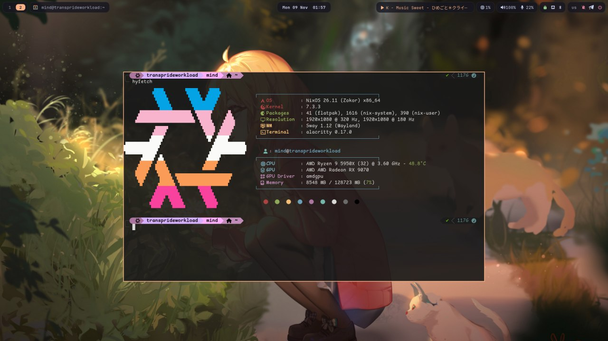
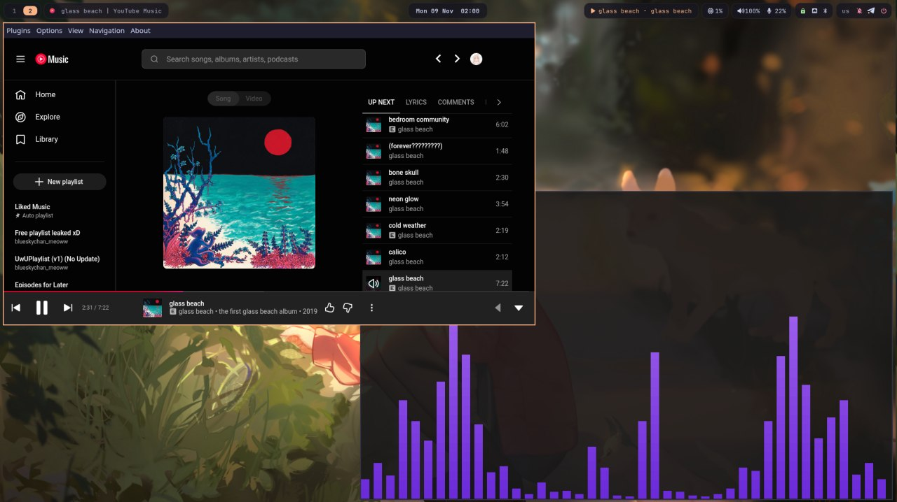
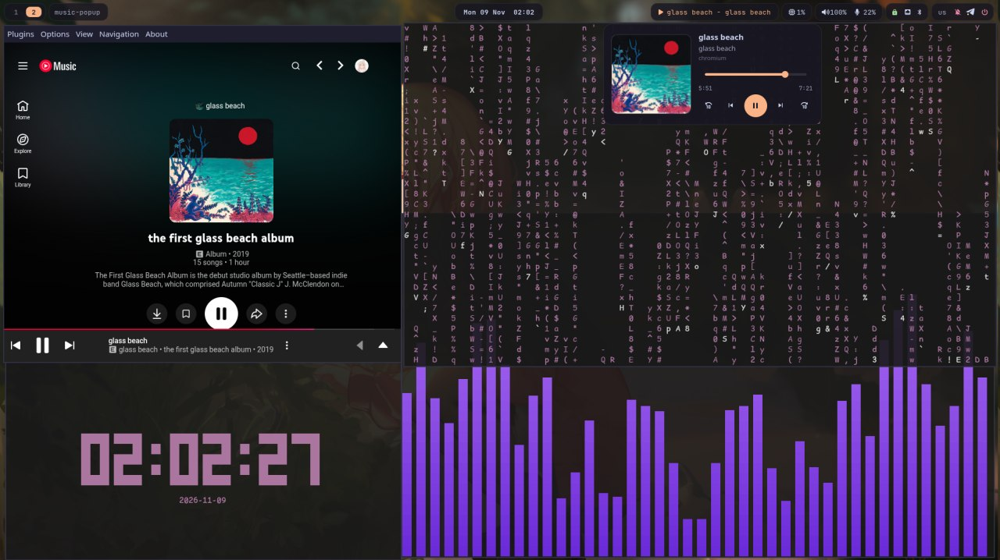
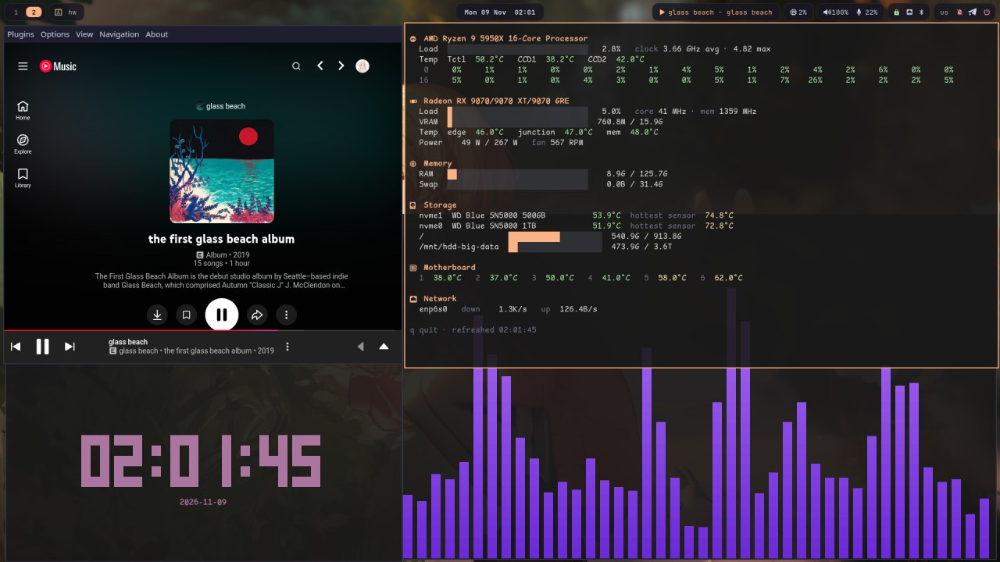
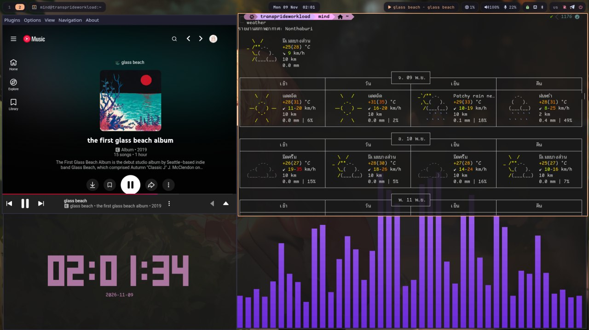

# nixos-config

NixOS configuration and dotfiles for `mizukioverflow`, a desktop workstation
running sway on Wayland.



> **Note:** This configuration is a work in progress, with rough edges and
> things that only make sense on this exact machine. Use it as a reference,
> not as something to deploy as-is.

<table>
  <tr>
    <td></td>
    <td></td>
  </tr>
  <tr>
    <td></td>
    <td></td>
  </tr>
</table>

## Use case

A daily-driver desktop used for:

- General desktop use, web browsing and music
- Software development: C/C++, Rust, Go, .NET, Node, Android, and ESP32
  firmware (ESP-IDF)
- VMs and containers: libvirt/QEMU, Incus, podman/distrobox
- Gaming: Steam titles and osu! (stable, via osu-winello) with a low-latency
  focus: high refresh displays, tuned pipewire buffers, gamemode, and a
  graphics tablet

## Overview

| | |
|---|---|
| **OS** | NixOS unstable, flakes |
| **Boot** | Lanzaboote (Secure Boot), latest kernel, ntsync |
| **Login** | greetd + ReGreet, running in a small sway session |
| **WM** | sway |
| **Lock** | hyprlock over a pre-blurred wallpaper, swayidle |
| **Bar** | waybar |
| **Launcher** | rofi |
| **Terminal** | alacritty (foot as backup) |
| **Notifications** | mako, with history, Do Not Disturb and a gamemode mode |
| **Shell** | zsh with oh-my-zsh and powerlevel10k |
| **Audio** | pipewire with low-latency pulse settings |
| **Theme** | Catppuccin Mocha (peach): adw-gtk3, Kvantum for Qt, Papirus-Dark icons |
| **Fonts** | JetBrains Mono Nerd Font, Comic Shanns Mono, Noto (CJK, emoji, Thai) |
| **Files** | Nemo, with gvfs/udisks for trash, phones and USB drives |
| **Media** | mpv (uosc + thumbfast), Loupe, pear-desktop (YouTube Music), Spotify, cava |

## Hardware

- **Board:** Gigabyte X570 GAMING X
- **CPU:** AMD Ryzen 9 5950X (16c/32t)
- **GPU:** AMD Radeon RX 9070 (16 GB), overclocking through LACT
- **RAM:** 128 GB, zram swap (zstd), no disk swap
- **Storage:** WD Blue SN5000 1 TB NVMe (NixOS, ext4), WD Blue SN5000 500 GB
  NVMe (Windows), 2 TB and 4 TB HDDs for data
- **Displays:** Acer VG250Q F3 (1080p, 320 Hz) + MSI (1080p, 180 Hz)
- **Input:** graphics tablet via OpenTabletDriver

## Layout

```
nixos-config/
├── flake.nix                   # entry point: nixpkgs unstable, lanzaboote, nix-index-database
├── flake.lock
├── sync.sh                     # copies the live config into this repo
├── hosts/
│   └── mizukioverflow/
│       ├── configuration.nix   # boot, users, services, mounts
│       └── hardware-configuration.nix
├── modules/
│   ├── packages.nix            # system packages and toolchains
│   ├── desktop.nix             # sway, portals, bluetooth, fonts
│   ├── greeter.nix             # greetd + ReGreet login screen
│   ├── regreet.css             #   its theme
│   ├── look.nix                # Qt theming (Kvantum), mpv, Loupe
│   ├── files.nix               # Nemo plumbing: gvfs, udisks, thumbnailers
│   ├── gaming.nix              # steam, gamemode, lact, tablet, app compat
│   ├── virtualisation.nix      # libvirt/QEMU, podman, distrobox
│   ├── incus.nix               # Incus containers/VMs + ct-login
│   ├── wireguard.nix           # wg0 with source-based policy routing
│   ├── sunshine.nix            # game streaming host (currently off)
│   ├── esp-idf.nix             # ESP32 toolchain deps + serial udev rules
│   └── tweaks.nix              # zram, nix gc/optimise, tmpfs /tmp, fstrim
├── dotfiles/
│   ├── alacritty/              # terminal
│   ├── cava/                   # audio visualizer + shaders
│   ├── dconf/                  # GTK settings
│   ├── hypr/                   # hyprlock lock screen
│   ├── mako/                   # notifications + click/history/DND scripts
│   ├── pipewire/               # low-latency pulse drop-in
│   ├── rofi/                   # launcher theme
│   ├── sway/                   # WM config + lock, wallpaper, screenshot, volume scripts
│   ├── waybar/                 # bar modules, styling, calendar pop-up
│   ├── zsh/                    # .zshrc, p10k config, shortcuts
│   └── bin/                    # ~/.local/bin scripts (see below)
└── screenshots/
```

## Usage

The live config is in `/etc/nixos` (flat, one directory). Apply it with:

```
sudo nixos-rebuild switch --flake /etc/nixos#mizukioverflow
```

`nrs` is an alias that stages the changes with git, updates the flake inputs
and switches.

This repo also builds on its own. `sync.sh` rewrites the imports to fit the
`hosts/` and `modules/` split, so this works from a clone:

```
sudo nixos-rebuild switch --flake .#mizukioverflow
```

### Syncing

`sync.sh` copies the live config back into the repo:

```
./sync.sh --dry    # show what changed, copy nothing
./sync.sh          # copy and git add, leaves it staged
./sync.sh --push   # copy, commit, push
```

It works from three tables at the top of the script:

- **`FILES`**: files in `/etc/nixos`. The script warns about any `.nix` or
  `.css` file there that the table doesn't list.
- **`DIRS`**: directories under `~/.config`, copied recursively. Backups
  (`*.bak*`, `*.pre-*`), editor leftovers and symlinks are skipped. Repo files
  whose source is gone are removed.
- **`HOME_FILES`**: single files from `$HOME`, such as the zsh config and the
  scripts in `~/.local/bin`.

Strings that must not end up in this public repo, such as server IPs, are
replaced on the way in. The list of them is kept in a git-ignored `.redact`
file. Because of that, `wireguard.nix` here has `ORACLE_IP` where the real
endpoint goes.

Dotfiles are still plain files in `~/.config` copied in by the script. They are
not managed declaratively yet.

## Keybindings

`Mod` is Super. Bindings use `--to-code`, so they work on both the US and Thai
layouts. Press `Mod+Shift+/` for the full searchable list (`keys`).

| Keys | Action |
|---|---|
| `Mod+Return` / `Mod+d` | terminal / launcher |
| `Mod+e` / `Mod+b` | Nemo / Brave |
| `Mod+q` / `Mod+f` | close / fullscreen |
| `Mod+1..0` | workspace 1–10 on the focused screen (`Shift` to move a window there) |
| `Mod+Ctrl+1..0` | workspaces 11–20 |
| `Mod+Space` | switch keyboard layout (us / th) |
| `Mod+Shift+Space` | toggle floating |
| `Mod+n` / `Mod+m` | screenshot region (screen frozen) / full |
| `Mod+Shift+v` | clipboard history |
| `Mod+w` / `Mod+Shift+w` | wallpaper picker / random wallpaper |
| `Mod+l` | lock |
| `Mod+Shift+n` / `Mod+Shift+d` | notification history / Do Not Disturb |
| `Mod+Alt+Space`, `←` `→` `↑` `↓` | play/pause, previous/next, volume |
| `Mod+Shift+e` | power menu |

## Desktop details

- **Per-screen workspaces:** `Mod+N` goes to slot N on whichever screen is
  focused. DP-1 has workspaces 1–10 and DP-2 has 11–20 (`ws.sh`).
- **Waybar:** a music pill (click it for the pop-up player), a CPU module that
  slides out temp/GPU/RAM/disk on hover, and audio, network and system
  groups. Clicking the clock opens a calendar.
- **Notifications:** clicking one opens the screenshot, link or app it came
  from. Every notification is logged for `Mod+Shift+n`. They are hidden while
  gamemode is active, except critical ones.
- **Screenshots:** wayfreeze freezes the screen before you select a region, so
  menus and tooltips can be captured. Shots are saved to
  `~/Pictures/Screenshots` and copied to the clipboard.
- **Wallpaper and lock:** picking a wallpaper pre-blurs it for the lock screen
  and copies it to the login screen (`greeter-sync.sh`). Locking is then
  instant.
- **Login:** ReGreet runs inside a small sway session instead of cage, so it
  gets the same monitor modes (320 Hz + 180 Hz) as the desktop.
  gnome-keyring is unlocked at login.
- Also: wlsunset night light, SwayOSD volume pop-ups, cliphist for text and
  images, and Thai text using Noto Sans Thai Looped.

## Scripts (`dotfiles/bin`)

| Script | What it does |
|---|---|
| `hw` | live hardware dashboard: CPU/GPU load and temps, RAM, disks, network |
| `keys` | searchable guide to this setup (fzf in a terminal, or rofi) |
| `music-popup` | the waybar music pop-up: art, seek bar, controls, works with any MPRIS player |
| `lab` | one fzf menu for Incus, libvirt and hand-built QEMU VMs |
| `net` | fzf menu for Wi-Fi, LAN and WireGuard |
| `upd` | check flake and Flatpak updates, preview them, pick what to apply |
| `clean` | pick what to clean up, see the exact commands, confirm, run |
| `gamemode-hold` | keep gamemode on for as long as a command runs (for osu-winello) |
| `motd-rice` | greeting shown when a terminal opens |
| `pc` | playerctl wrapper |

## System details

- **Secure Boot** goes through Lanzaboote, with keys in `/var/lib/sbctl`.
  systemd-boot is force-disabled because Lanzaboote replaces it.
- **WireGuard (`wg0`)** uses `table = off` plus a policy rule, so only
  traffic sourced from the tunnel address goes through it. Normal traffic
  stays on the LAN. Keys are read from `/etc/wireguard`, not the Nix store.
- **Incus** is configured with a preseed: an `incusbr0` bridge on
  10.0.100.0/24 with NAT, a `dir` storage pool, and a 35 GiB root disk by
  default. `ct-login` is a whiptail menu that picks a container and a user to
  log in as.
- **libvirt/QEMU** has swtpm for Windows 11, SPICE USB redirection and
  virtiofsd. AVIC and `iommu=pt` are on.
- **ESP-IDF:** nix-ld provides the libraries Espressif's prebuilt toolchains
  expect, and udev rules give access to CP210x, CH340, FTDI and Espressif
  USB-JTAG.
- **Performance:** `performance` governor, `preempt=full`, tmpfs `/tmp`,
  zram, swappiness 10, rtprio/memlock limits for `@audio`.
- **Maintenance:** the nix store is garbage-collected weekly (anything older
  than 14 days) and auto-optimised, and fstrim runs.
- Also running: Syncthing, BOINC, OpenSSH (keys only), Flatpak, AppImage
  binfmt.

## Known issues and workarounds

Problems I have personally hit on this setup, and how to get around them.

- **osu-wine does not run directly.** Launching `osu-wine` (or the installer
  `./osu-winello.sh`) fails on NixOS because the tooling assumes an FHS
  filesystem (`/bin/true`, `/usr/lib`, etc.). Run it through steam-run:
  `steam-run ./osu-winello.sh` to install, `steam-run osu-wine` to play.
  `programs.steam.enable` must be on for steam-run to exist.
- **Reboot can hang to a black screen** (X570 firmware quirk). `reboot=acpi`
  is set in kernelParams as the workaround.
- **Outputs come up in random order at boot**, so the greeter used to open on
  the wrong screen. The greeter's sway config moves the ReGreet window to DP-1
  when it appears.

## License

Do whatever you want with it. Attribution appreciated but not required.
